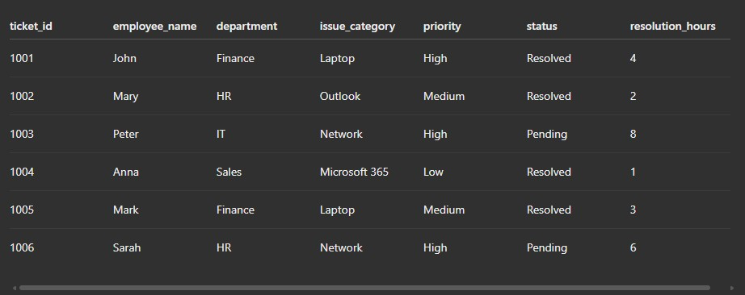
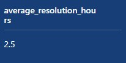
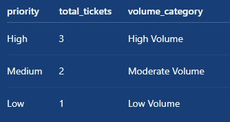

# IT Helpdesk Database Analysis

## Project Overview

This project demonstrates the use of SQL to analyze a sample IT Helpdesk database. The goal is to identify ticket trends, monitor resolution performance, and generate useful insights from helpdesk records.

## Business Objectives

- Analyze the total number of IT support tickets.
- Identify resolved and pending tickets.
- Calculate the average ticket resolution time.
- Analyze ticket volume by priority.
- Identify departments with multiple support requests.

## Database Tables

**1. Employees**
- employee_id
- employee_name
- department
- job_title

**2. Tickets**
- ticket_id
- employee_name
- department
- issue_category
- priority
- status
- resolution_hours

## SQL Skills Demonstrated

- CREATE TABLE and INSERT
- SELECT and WHERE
- COUNT and AVG
- GROUP BY and ORDER BY
- CASE WHEN
- INNER JOIN and LEFT JOIN
- HAVING

## Key Findings

| Metric | Result |
|---|---:|
| Total Tickets | 6 |
| Resolved Tickets | 4 |
| Pending Tickets | 2 |
| Average Resolution Time | 2.5 hours |

### Ticket Volume by Priority

| Priority | Tickets |
|---|---:|
| High | 3 |
| Medium | 2 |
| Low | 1 |

### Department Analysis

| Department | Tickets |
|---|---:|
| HR | 2 |
| Finance | 2 |

## Project Files

- [database.sql](database.sql) – Database schema and sample records.
- [analysis.sql](analysis.sql) – SQL queries used for analysis.
- [results.md](results.md) – Project findings and conclusions.
## SQL Query Screenshots

## Conclusion

The analysis shows that 4 out of 6 tickets were resolved, with an average resolution time of 2.5 hours. High-priority tickets represent the largest portion of the sample dataset.

**Note:** This project uses fictional sample data for educational and portfolio demonstration purposes.
